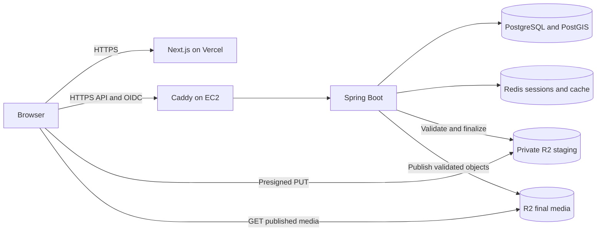

# OpenNest deployment and infrastructure plan

Status: Phase 0 proposal, reviewed against provider documentation on 21 October 2026. Only the local datastore Compose file and foundation CI exist. Production Compose, Dockerfiles, Caddy configuration, cloud resources, application builds, and deployment workflows are not implemented.

This replaces the supplied deployment draft where it conflicts with the [project plan](PROJECT_PLAN.md), [authentication decisions](AUTHENTICATION.md), or existing infrastructure. OpenNest remains India-wide and licensed under [AGPL-3.0-only](../LICENSE). Hosting in Mumbai does not limit listing coverage to that region.

## Maintainer preferences

- Start as a personal, non-commercial project with the lowest practical cost; increase spending if usage justifies it. No fixed monthly spending limit has been chosen.
- No AWS account or credits exist yet. Eligibility, available services, credit balance, and expiry must be checked after account creation.
- No domain is owned yet. Hostnames below are examples, not registered OpenNest addresses.
- Begin with local development and isolated previews. Choose the public deployment's budget and domain arrangement before provisioning it. This document does not authorize purchases or deployment.

## Proposed stack and cost boundaries

| Layer | Plan | Cost or readiness constraint |
| --- | --- | --- |
| Source | Public GitHub monorepo, future `backend/` and `frontend/` directories, AGPL-3.0-only | Third-party components retain their own licenses. Publish a source link for the running revision. |
| Frontend | Next.js 16.4 / React 19.3 / TweakCN on Vercel, future root directory `frontend` | Hobby is a candidate for the confirmed personal, non-commercial start, within its limits. Reassess eligibility before commercialization; open source alone does not grant a special free production plan. [Vercel Hobby](https://vercel.com/docs/plans/hobby), [fair use](https://vercel.com/docs/limits/fair-use-guidelines). |
| Backend | Java 21 / Spring Boot 4.1.1 / Modulith, built in CI and run on EC2 behind Caddy | Mumbai `ap-south-1` is a candidate. Start by evaluating an x86-64 host; instance type and memory depend on price and load tests. ARM requires a different, tested PostGIS image strategy. |
| Database | PostgreSQL/PostGIS on a private container network, persistent encrypted EBS storage | Local baseline is PostgreSQL 17 / PostGIS 3.5. Keep CI and production versions aligned; do not copy the draft's PostgreSQL 16 downgrade. Off-host backups incur separate storage/operation costs. |
| Sessions and cache | Dedicated Redis per production/sandbox environment, backend-owned Spring sessions | Local baseline is Redis 7.4. Use `noeviction` for session-bearing Redis; PostgreSQL remains authoritative for quotas. License and supported production version need review below. |
| Photos | Cloudflare R2 Standard, direct browser presigned PUTs, validated immutable final images | Monthly free allowance is 10 GB-month storage, 1 million Class A operations, and 10 million Class B operations. Egress is free under current pricing; storage/operations beyond allowances are billable. The allowance excludes Infrequent Access. [R2 pricing](https://developers.cloudflare.com/r2/pricing/). |
| DNS and TLS | Cloudflare DNS if a domain is acquired; Caddy on the API host | Domain registration/renewal is separate. DNS-only records do not provide HTTP caching or bot protection. Proxy/WAF behavior must be explicitly configured; do not promise that all scraping is blocked. [Cloudflare proxy status](https://developers.cloudflare.com/dns/proxy-status/). |
| Identity | Google OIDC through Spring Security; Redis sessions | Google login does not verify phone ownership. WhatsApp remains disabled pending the separate review in [AUTHENTICATION.md](AUTHENTICATION.md). There is no approved zero-cost phone-verification service. |
| Maps and nearby places | MapLibre GL JS plus a separately selected tile/style provider; optional Overpass enrichment | MapLibre renders supplied map data; it does not include production tile hosting or address search. Provider choice and usage allowance remain open. [MapLibre documentation](https://maplibre.org/maplibre-gl-js/docs/). |
| Build and registry | GitHub Actions, GHCR, immutable image digests | Standard hosted runners are free for public repositories; larger runners are charged. Public packages are free under current terms. Check artifact/cache quotas separately. [Actions billing](https://docs.github.com/en/billing/concepts/product-billing/github-actions), [Packages billing](https://docs.github.com/en/billing/concepts/product-billing/github-packages). |
| Review and operations | Existing CodeRabbit guidance; planned security scanning and basic monitoring | Cubic and Sentry are optional, unconfigured services. Their eligibility/quotas must be checked if selected; no spend or installation is assumed. |

Vercel's CDN delivery is distinct from server rendering. Select a supported function runtime/region near the API where possible; do not describe all Next.js SSR as globally distributed Edge execution. [Vercel runtimes](https://vercel.com/docs/functions/runtimes), [function regions](https://vercel.com/docs/functions/configuring-functions/region).

### AWS offers are temporary, account-specific inputs

AWS currently advertises up to USD 200 for new customers: USD 100 initially and up to USD 100 earned through qualifying activities. The Free plan ends after six months or credit exhaustion, whichever occurs first; continuation requires the appropriate account plan. Confirm actual account terms before relying on these amounts. [AWS Free Tier](https://aws.amazon.com/free/).

The separate T4g trial currently offers 750 aggregate `t4g.small` instance hours per month through **31 December 2026**, including Mumbai. It is not 750 hours per instance or per region. Surplus CPU credits can still be charged, and the offer does not resolve the ARM image incompatibility below. Do not assume an extension. [EC2 T4g FAQ](https://aws.amazon.com/ec2/faqs/).

Prepare a quote for compute, EBS capacity/IOPS, snapshots/backups, public IPv4, outbound transfer, logs, domain renewal, and any paid provider usage, including applicable tax/currency conversion. For scale, one AWS public IPv4 address at USD 0.005/hour is USD 3.60 over 720 hours before allowances/credits. EBS and other services have their own rates. [Public IPv4 pricing](https://aws.amazon.com/vpc/pricing/), [EC2 pricing](https://aws.amazon.com/ec2/pricing/on-demand/).

Set billing alerts and provider limits before public access; alerts alone do not stop spend. Track credit expiry and decide whether to pay, reduce capacity, or stop the pilot before it expires. Stopping compute does not remove retained storage or other billable resources. No INR 0/month or lifetime-free guarantee is established.

## Versions, architecture, and licenses

- Official release pages confirm [Spring Boot 4.1.1](https://spring.io/blog/2026/08/20/spring-boot-4-1-1-available-now/), [Next.js 16.4](https://nextjs.org/blog/next-16-4), and [React 19.3](https://react.dev/blog/2026/09/09/react-19-3). Java 21 is within Boot's documented supported range. This verifies release availability, not an OpenNest build or dependency compatibility. Resolve exact patched dependencies and the Modulith/BOM combination during bootstrap. [Boot requirements](https://docs.spring.io/spring-boot/system-requirements.html).
- The upstream `postgis/postgis` README currently lists **amd64 only**. Therefore the supplied Compose file is not a native `t4g.small` deployment. The simplest proposed path is x86-64 compute with a tested upstream image. ARM remains possible with a maintained native PostGIS build or a separately hosted compatible database, after migration, backup, extension, and performance tests. Do not use emulation as the production workaround. [PostGIS image architecture](https://github.com/postgis/docker-postgis).
- Temurin currently publishes Java 21 Alpine images for amd64 and arm64. That does not make the whole stack multi-architecture. Inspect each exact image manifest, pin digests, and run integration tests on the target architecture. [Official Temurin image metadata](https://github.com/docker-library/official-images/blob/master/library/eclipse-temurin).
- Redis 7.4 uses RSALv2/SSPLv1; it is not the BSD-licensed Redis of older releases. Redis 8 adds an AGPLv3 option. Keep the current local version unchanged in this documentation task, and evaluate a supported Redis 8 release under its AGPL option before production if an entirely open-source datastore stack is required. That upgrade needs Spring Session/client, persistence, and memory testing. [Redis licensing](https://redis.io/legal/licenses/).
- Do not use mutable `latest` tags for releases. Record application commit, image digest, architecture, database/extension versions, and corresponding-source location together. Do not change a database image's major version against an existing volume without an upgrade/restore plan.

## Network and browser-session topology

Proposed public topology once a domain is selected:

For example, `app.example.com` on Vercel and `api.example.com` on EC2 are different origins within the same HTTPS site. The API host owns its host-only session cookie. Browser API calls include credentials; CORS allows only the exact frontend origin with credentials, and mutations require the synchronizer CSRF token. CORS does not replace authentication or CSRF protection. Keep `Secure`, `HttpOnly`, and `SameSite=Lax` as specified in [authentication](AUTHENTICATION.md). [Browser cookie semantics](https://developer.mozilla.org/en-US/docs/Web/HTTP/Reference/Headers/Set-Cookie).

Send login navigation to `/oauth2/authorization/google` on the API origin and register its exact `/login/oauth2/code/google` callback with Google. Application REST paths remain `/api/v1/...`. Redirect successful login to the configured frontend without forwarding authorization codes or tokens. With an API-host-only cookie, Next.js SSR cannot assume it receives that cookie: initially load private account data through credentialed browser requests. A future same-origin proxy would need explicit cookie, redirect, forwarding, and cache tests.

An unrelated `*.vercel.app` frontend and API domain are cross-site; they do not satisfy this cookie plan by merely adding a CORS entry. Until a domain or tested same-origin routing is available, use local development and isolated demo previews. Do not weaken cookies or enable production credentials for arbitrary preview URLs. Preview builds and sandbox deployments get no production secrets or data access.

Expose only Caddy's required HTTP/HTTPS ports publicly. Keep PostgreSQL, Redis, the backend port, Caddy administration, and management/telemetry endpoints off the public network. Restrict administrative access. Trust forwarded host/protocol/client-IP headers only from configured proxies, never from arbitrary requests.

Caddy needs a valid hostname, certificate storage, and a working ACME challenge route. If Cloudflare proxies the API, configure Full (strict) origin TLS and test certificate issuance/renewal. DNS challenges require the appropriate Caddy DNS module and scoped credentials; do not assume the default image includes it. [Caddy HTTPS](https://caddyserver.com/docs/automatic-https), [Cloudflare Full (strict)](https://developers.cloudflare.com/ssl/origin-configuration/ssl-modes/full-strict/).

Only eligible unauthenticated production listing responses may use shared caches, following [LISTING_SEARCH.md](LISTING_SEARCH.md). Auth, contact, authenticated, and all sandbox responses are `no-store` at every layer. Bypass caching for requests carrying session/auth credentials and responses setting cookies; no blanket API or OAuth cache rule.

### Recruiter isolation

Use a separate frontend deployment/configuration where needed and a separate backend deployment, PostgreSQL instance, Redis instance, credentials, session cookies/stores, OAuth client if enabled, signing keys where used, storage buckets or enforced prefixes, and cache namespaces. Provision separate container networks and prohibit sandbox access to production stores. Prefer separate hosts for the public demo when budget permits; shared-host containers still share a kernel, administrator, and failure domain.

Untrusted headers never select production versus sandbox data. Production disables demo personas, resets, and demo telemetry. Sandbox fixtures are fabricated across Indian cities, with callable contacts disabled. A local Compose profile is not proof of application isolation. Test cross-environment credential, session, reset, and storage access rejection. Do not fit a second backend and datastore pair into the production memory estimate without measuring them separately.

## Capacity and recovery

The supplied 350 MB JVM / 512 MB database / 96 MB Redis / 2 GB swap budget is unmeasured. A 2 GiB machine is a candidate for a small pilot, not a guaranteed capacity target. Benchmark the real application before selecting it; use a larger host if it cannot maintain headroom. The OS is not a Docker-limited container, and unused RAM is not a fixed promise.

| Component | Measure before fixing limits |
| --- | --- |
| Spring Boot | Peak RSS during startup, migrations, OIDC, uploads/validation, and concurrent nationwide searches; include heap, metaspace, code cache, direct buffers, and native/thread memory. |
| PostgreSQL/PostGIS | Connections and concurrent sort/hash/spatial queries, autovacuum, indexes, temporary files, and backup activity. `work_mem` can apply to multiple operations per query; it is not a server-wide cap. [PostgreSQL memory settings](https://www.postgresql.org/docs/17/runtime-config-resource.html). |
| Redis | Dataset plus allocator/buffers and persistence rewrite peaks. Leave memory above `maxmemory`; cap sessions/cache growth with TTLs and bounded writes. |
| Host and Caddy | OS, Docker, TLS connections, page cache, monitoring, image pulls, and log/disk growth. Reserve measured headroom. |

Do not adopt `-Xss256k`, a tight metaspace cap, Serial GC, or `TieredStopAtLevel=1` merely to match a spreadsheet. Keep JVM defaults until representative measurements justify changes. Bound request concurrency, database pools, query duration, payload sizes, pagination, and rate limits; a small host cannot absorb unlimited traffic.

Use `noeviction` for Redis that holds sessions. `allkeys-lru` can remove authentication state; memory pressure under `noeviction` instead rejects memory-growing writes, which the application must handle with a controlled failure. Keep cache populations bounded or later move evictable cache data to a separate instance. Redis logical databases/namespaces do not isolate memory or eviction. [Redis eviction](https://redis.io/docs/latest/develop/reference/eviction/).

Swap may provide emergency buffering but is slower than RAM and does not prevent OOM kills, container limit failures, or outages. If selected after testing, configure encrypted-disk swap idempotently and monitor it; do not rerun commands that recreate an active swap file or append duplicate `fstab` entries. Use supported Docker package installation for the selected OS. [Docker memory and swap constraints](https://docs.docker.com/engine/containers/resource_constraints/).

Named volumes, `restart: unless-stopped`, and Redis AOF do not guarantee recovery in three seconds or zero data loss. Define recovery point/time objectives, automate encrypted off-host database backups, and test a restore onto a fresh host. Redis recovery must not reset PostgreSQL-backed quotas or extend/revive revoked sessions; choose session invalidation after restore unless revocation/expiry continuity is proven. Keep backup credentials and retention separate from public media access.

## Requirements for later deployment files

Create production artifacts only after application builds and the decisions below are ready. Keep the existing [local Compose](../docker-compose.yml) local; its development users/password handling are not production roles.

1. **Production Compose:** pin tested image digests; configure explicit memory/CPU/log limits and inspect effective limits on the actual host. Keep persistent volumes and private networks. Map environment configuration consistently and fail on missing required secrets. Do not pass the entire shared environment file to every container.
2. **Startup checks:** use `service_healthy` for PostgreSQL and Redis, with real healthchecks; `service_Started` from the draft is invalid. PostgreSQL readiness must include `pg_isready -h 127.0.0.1 -U "$${POSTGRES_USER}" -d "$${POSTGRES_DB}"`. Redis healthchecks must honor its configured authentication. Startup ordering does not handle later outages; application timeouts/retries and readiness still matter. [Compose dependency conditions](https://docs.docker.com/compose/how-tos/startup-order/).
3. **Database roles:** give the app a restricted runtime role; run Flyway with a separate migration role. Keep Hibernate in validation mode. Reserve connections for migrations/maintenance and size the application pool below database capacity. Do not reuse development superuser credentials.
4. **Backend image:** build with the Maven wrapper in CI, using Java 21 and a verified target architecture; run tests before publishing. Copy one explicitly identified executable JAR into a minimal non-root runtime, with secrets excluded from layers/build context. Preserve license/source metadata. A Docker build that skips tests is acceptable only after that exact revision passed the test job.
5. **Proxy configuration:** route the API and OIDC framework paths, implement the chosen certificate setup and trusted forwarding, redact callback query strings, bound request sizes/timeouts, and protect management paths.
6. **Secrets:** store production secrets in restricted deployment configuration. Reuse documented names from [.env.example](../.env.example), including `GOOGLE_CLIENT_ID`, `GOOGLE_CLIENT_SECRET`, `R2_ACCOUNT_ID`, `R2_ACCESS_KEY_ID`, `R2_SECRET_KEY`, and `R2_BUCKET`. `DB_*` are existing local inputs; production runtime/migration credentials will need explicit names and mappings. New settings must be documented alongside implementation, never inferred from a pasted example.
7. **Authentication configuration:** no `JWT_SECRET`, `OTP_PROVIDER=CONSOLE_DEV`, hardcoded bot number, or implicit WhatsApp activation. Origins/URLs are literal configured URLs, not Markdown links; production origin allowlists exclude localhost and arbitrary previews. Missing required production configuration fails closed.

### Media and map services

Keep uploads direct to R2 and validate/finalize them according to the [API contract](ai-context/API_CONTRACTS.md). Use private staging with short-lived PUT URLs; keep staging objects, draft images, and backups private. A final object must not remain writable through a staging URL. Configure exact-origin bucket CORS and separate production/sandbox credentials and storage. When using different staging/final buckets, add explicit configuration rather than overloading the existing single `R2_BUCKET` placeholder.

Presigned uploads use R2's S3 API hostname, not a custom media CDN domain. Use an approved custom-domain/public-read arrangement only for intentionally published media; `r2.dev` is development-only and rate-limited. Define removal/cache-purge handling for paused/deleted listings where required by the media privacy policy. [R2 presigned URLs](https://developers.cloudflare.com/r2/api/s3/presigned-urls/), [public buckets](https://developers.cloudflare.com/r2/buckets/public-buckets/).

Select map tiles/styles/fonts, attribution, usage limits, and any geocoder separately. OSM data being open does not make its community tile servers an unlimited production CDN. [OSM tile policy](https://operations.osmfoundation.org/policies/tiles/).

The public Overpass instance's operator discourages using it as the backend of a public application. For production, choose an operator-approved provider or separately budgeted self-hosted service; otherwise leave enrichment disabled. Do not add a full Overpass instance to the small API machine. Retain the planned 2500 ms timeout, circuit breaker, bounded/cached enrichment, and empty-result fallback; failures must never block saving a listing. Label proximity as approximate mapped-data distance, not guaranteed walking distance or exhaustive coverage. [Overpass resource policy](https://dev.overpass-api.de/overpass-doc/en/preface/commons.html).

## Delivery and operational checks

Current foundation CI only validates local Compose, datastore startup, PostGIS/Redis behavior, persistence, and AI-context size. It does not build an application or deploy anything.

Planned delivery sequence:

1. Pull requests run backend tests against PostGIS/Redis, module-boundary and isolation tests, frontend type/build checks, and appropriate security scans when those sources exist. Review guidance comes from [AGENTS.md](../AGENTS.md) and CodeRabbit configuration; `CLAUDE.md` points to that guidance. Row-level `is_sandbox` checks are not the isolation design.
2. Add CodeQL for supported Java/TypeScript code, dependency/container scanning, and separate secret scanning/push protection. CodeQL is not a secret-leak prevention guarantee. Verify enabled repository settings and handle supported-pattern limits. [GitHub push protection](https://docs.github.com/en/code-security/concepts/secret-security/push-protection).
3. Build and publish tested release images to GHCR with commit tags and immutable digests; keep privileges minimal. Untrusted PR code receives no production secrets, deployment permissions, or access to the production host.
4. Promote a selected frontend build and backend digest only after explicit maintainer approval in a protected deployment environment. Configure Vercel promotion accordingly; a merge to `main` alone must not silently authorize a production deploy. Serialize deployments and identify the exact approved revision.
5. Check backup/restore readiness and migration compatibility, apply reviewed Flyway migrations, start the release, and verify readiness plus login/search/upload smoke tests. A single backend may have deployment downtime. No claim of zero downtime or zero data loss is made.
6. Retain the previous image and a tested rollback procedure. Application rollback is safe only with a compatible schema; otherwise use a reviewed forward fix or restore plan. Never automatically run destructive reverse migrations or remove volumes.

Monitor uptime, HTTP errors/latency, JVM RSS, database pool/query time, Redis write failures, disk/WAL/AOF growth, CPU credits, backup age, and provider spend. Optional Sentry must redact contacts, authorization headers, cookies, tokens, signed URLs, and callback parameters. Keep logs bounded and test degraded behavior before increasing traffic.

## Decisions before public deployment

- Confirm the AWS account plan, eligible credits/expiry, complete monthly quote, spending alerts, and an acceptable recurring budget.
- Select an available x86-64 instance/image combination; approve ARM only after native database testing. Benchmark capacity and decide where the separate recruiter deployment will run.
- Acquire/select a domain arrangement for same-site Google sessions and media delivery, or implement and test an equivalent same-origin proxy. Configure exact OAuth redirects and production/sandbox origins.
- Review the production Redis version/license and map tile/Overpass provider. Pin supported patches and test upgrades against the chosen images.
- Complete the existing phone-verification, moderation, privacy, backup/restore, and load-test requirements in the [project plan](PROJECT_PLAN.md). Google login alone cannot unlock owner publication.

Update this document and [ARCHITECTURE_STATE.md](ai-context/ARCHITECTURE_STATE.md) when a proposal becomes a tested deployment decision. Recheck provider terms and prices at provisioning time; the review date above is not a permanent guarantee.
